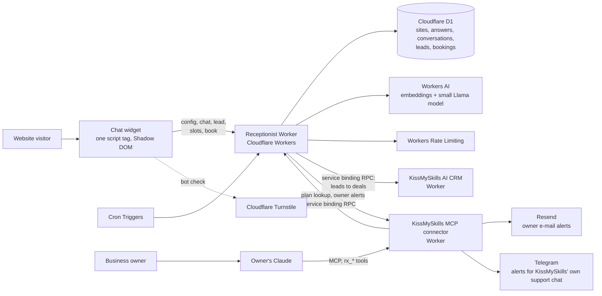

# KissMySkills AI Receptionist

**A website chat for small businesses that answers only from the owner's approved answers, books visits into free slots, and hands everything else to a human, set up and managed by the owner's own AI agent through MCP.**

Live product page: [kissmyskills.com/pages/ai-receptionist](https://kissmyskills.com/pages/ai-receptionist)

## The problem

Small service businesses such as salons, studios, clinics and small online shops lose enquiries outside working hours. The usual chatbots have two failure modes. Either they make things up, inventing prices or opening hours, or they take hours of setup the owner never finishes. The owner also can't see which questions visitors asked that the website didn't answer.

## Who it's for

- Owners of small service businesses and online shops who want after-hours answers and bookings without hiring someone.
- People who already work with an AI assistant (Claude) and would rather say "set up a receptionist for my website" than fill in a settings panel.

## Key features

- **Grounded answers.** The assistant replies from a base of ready Q/A pairs that the owner approved. A small model may only rephrase or combine those answers. If the rephrased reply contains a number, price, time, e-mail or link that isn't in the source answers, it is discarded and the original answer is sent instead.
- **Honest handoff.** When nothing relevant matches, the assistant says it will pass the question on and collects the visitor's name and contact as a lead. Visitors can also ask for a person at any time.
- **Booking.** Opening hours, services and slot rules are set per business and time zone. Visitors pick a free slot right in the chat.
- **Setup by the owner's agent.** 23 `rx_*` MCP tools let the owner's Claude create the site, import the website, write and approve answers, test the chat, set hours and get the embed code. There is also one-click autosetup: it reads the website and drafts Q/A pairs, which stay drafts until the owner approves them.
- **"What it couldn't answer" loop.** Unanswered questions are grouped, counted and shown next to the closest existing answer. Requests to talk to a person go on the same list, which works as the owner's to-do list for improving the answer base.
- **Owner alerts and CRM.** Leads and bookings can become deals in the KissMySkills AI CRM. The owner gets e-mail alerts, batched into digests when there are many. Visitor contacts are masked in alerts.
- **One-line install.** A single script tag, with step-by-step guides for common website platforms and a server-side check that the widget is live on a given page.
- **Configurable widget.** Position, launcher, avatar, light/dark/auto theme, 10 interface languages and a compact size. It runs in Shadow DOM so it doesn't clash with the host site's styles.
- **Privacy by design.** E-mails and phone numbers are removed from transcripts before storage and before any model call, and visitor IPs are stored only as salted hashes. A daily job deletes old data under fixed retention periods, and there are tools for GDPR access and erasure requests.

## How it works

How a visitor message is handled:

1. Contact details are removed from the message. If the visitor asks for a person, the chat shows the lead form. If they want to book and the business has a schedule, it shows the booking card.
2. The answer base is searched with embeddings stored in D1, using cosine similarity plus an IDF keyword score as a fallback.
3. If there is one clear match, that ready answer is sent word for word, with no LLM call.
4. If there are several partial matches, a small model rephrases only those answers. The output must pass the grounding check described above.
5. If the AI budget is used up, the model fails or the output is ungrounded, the best ready answer is sent word for word.
6. If nothing is relevant, the visitor gets a handoff and a lead form, and the question goes on the owner's "couldn't answer" list.

The owner never logs into the Worker directly. Owner and agent operations go through RPC over a service binding from the MCP connector, which handles authentication, so no owner endpoint can be reached from a browser.

## Tech stack

- **Runtime:** Cloudflare Workers, plain JavaScript with no runtime dependencies. The widget is ES5 and bundled as text.
- **Data:** Cloudflare D1 (SQLite) with versioned migrations.
- **AI:** Workers AI. `bge-small-en-v1.5` creates the embeddings and Llama 3.2 3B Instruct does the grounded rephrasing and autosetup drafting. Bring-your-own-key (Anthropic/OpenAI) per site is built but off behind a feature flag.
- **Platform:** Turnstile for bot checks, Workers Rate Limiting, Cron Triggers for retention and alert batching, and Service Bindings (WorkerEntrypoint RPC) to the MCP connector and the CRM.
- **Integrations:** Model Context Protocol through the KissMySkills connector, Resend for e-mail, and Telegram for live replies on KissMySkills' own support chat.
- **Quality:** Vitest, with D1 emulated on SQLite and the real migrations applied. A separate staging environment has its own database and bindings.

## My role

I worked on this as **product manager and builder**, writing the code with Claude Code as my engineering pair.

- **Problem framing and spec.** I defined the target user, the "never invent facts" rule, the handoff behaviour and the loop that shows the owner what went unanswered. I wrote cost and abuse limits into the spec as requirements.
- **MVP-first.** I first shipped a standalone demo on a fictional business, "Copper Comb Hair Studio", to test the experience before building anything multi-tenant. A few days later it became a multi-tenant product connected to the existing KissMySkills MCP connector and AI CRM.
- **Prioritising.** The order was: grounded answers and handoff first, then booking, the requests list and one-click autosetup, then privacy and retention, owner alerts, CRM boards and finally install guides and appearance. E-mail replies to visitors are explicitly out of scope for now, and the tools say so instead of pretending.
- **Staged releases.** Every change got its own feature branch, was verified on a separate staging environment with its own data, and was released through a release branch. Feature flags and kill switches protect risky pieces.

## What I learned / product decisions

- **Trust beats fluency.** For a business, a wrong price from a chatbot is worse than no answer. So the model never writes facts. It rephrases approved answers, or on stricter sites it only picks which approved answer fits. When in doubt the receptionist hands off to a human.
- **Let the customer's agent do the thinking.** Setup and improvement run in the owner's own Claude through MCP tools. The server stores data and runs a small model only for live visitor replies. This keeps running costs predictable and makes setup a conversation rather than a form. One-click autosetup was added later for owners without an agent, and its drafts always need explicit approval.
- **Unanswered questions are the feedback loop.** Each question the receptionist couldn't handle becomes a grouped, counted request next to the closest existing answer, so the answer base improves from real visitor demand rather than guesses.
- **AI cost is a product constraint, not an ops detail.** Every model call reserves its worst-case cost first, there are per-site AI cost caps and abuse protection, and running out degrades gracefully to verbatim answers. Visitors never see an error caused by the budget.

---

Source is private; happy to walk through it in an interview.

More detail: [data model](docs/data-model.md) · [API and MCP surface](docs/api-and-mcp-surface.md)
