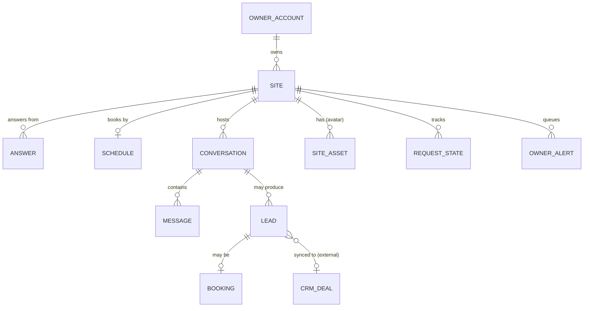

# Data model (sanitized sketch)

The data is stored in Cloudflare D1 (SQLite) and built up through versioned migrations. Only the entities and how they relate are shown here. Column-level details and operational tables (usage counters, cost ledgers) are left out.

| Entity | What it holds |
|---|---|
| **Owner account** | External. It is the KissMySkills account authenticated by the MCP connector, and the receptionist stores only a reference to it. |
| **Site** | One receptionist per website. It holds the public site id used in the embed tag, the allowed domains, widget settings and appearance, and a cached plan. |
| **Schedule** | Part of a site. It covers the time zone, weekly hours, bookable services with their durations, slot rules and closed dates. |
| **Answer** | A ready Q/A pair with optional alternative phrasings and tags, plus its embedding vector. Its status is `draft` or `live`, and only live answers reach visitors. |
| **Conversation** | One widget session. It records the page, a salted visitor hash (raw IPs are never stored), its status (`open`, `lead` or `booked`) and a flag for test chats. |
| **Message** | A visitor, assistant or team message, with contact details removed. Assistant messages record how the reply was produced (`answer`, `ai`, `fallback`, `handoff`, `booking`), along with the retrieval score and which answers were used. |
| **Lead** | A name, contact and question left by a visitor. Its status is `new`, `replied` or `closed`, and it carries an optional link to a CRM deal. |
| **Booking** | A service, date and time in the site's time zone, with a reference code. Its status is `booked` or `cancelled`. |
| **Request state** | The owner's status (`open` or `done`) for a computed request. A request is either an unanswered question group or a "talk to a person" conversation, and it can also link to a support CRM card. The requests themselves are derived from recent messages and leads. |
| **Owner alert** | A pending or sent e-mail alert about one conversation (handoff, lead or booking). It stores only a summary with contact details removed and a masked contact. |
| **Site asset** | An uploaded widget avatar, served under a cache-busting URL. |

Retention: a daily scheduled job deletes conversations and messages, and later leads and bookings, after fixed retention periods. Owners can also delete one conversation, one lead or the whole site on request.
